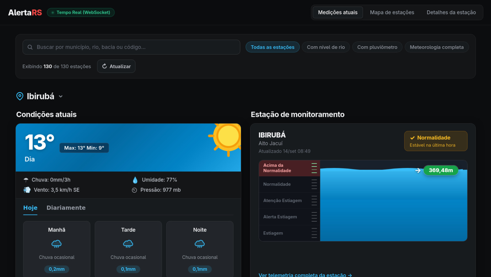
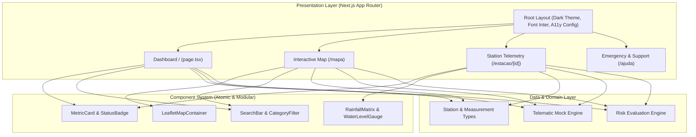

# AlertaRS Web

[](https://nextjs.org/)
[](https://www.typescriptlang.org/)
[](https://tailwindcss.com/)
[](https://www.w3.org/WAI/standards-guidelines/wcag/)

> Plataforma web de monitoramento hidrometeorológico em tempo real e alerta precoce de inundações para os municípios do Rio Grande do Sul.

<p align="center">
  
</p>

> [!NOTE]
> Projeto desenvolvido no âmbito da disciplina **Projeto Integrador IV-B (Interface Humano-Computador e Programação Front-End)** do Curso Superior de Tecnologia em Análise e Desenvolvimento de Sistemas da **Universidade de Caxias do Sul (UCS)**.

---

## Overview

O **AlertaRS Web** traduz dados telemétricos abertos de órgãos governamentais (Defesa Civil RS, CPRM/SGB, ANA e CPTEC) em uma interface cidadã, acessível e responsiva. O objetivo central é democratizar a leitura do risco hidrológico para moradores de bacias críticas, voluntários e agentes públicos, priorizando o acesso veloz em dispositivos móveis (*mobile-first*) mesmo em conexões degradadas.

> [!IMPORTANT]
> Toda a experiência do usuário foi projetada sobre as **10 Heurísticas de Usabilidade de Nielsen** e em conformidade estrita com o nível **WCAG 2.2 AA**, garantindo contraste elevado (> 4.5:1), navegação integral por teclado e independência de identificação cromática para usuários daltônicos.

---

## Features

- **Painel Situacional Consolidado:** Contadores em tempo real de bacias monitoradas, estações ativas e cidades em risco iminente.
- **Classificação Semântica de Risco:** 4 faixas de criticidade visual e textual:
  - `Normal` (verde): Cota fluvial estável dentro da calha de segurança.
  - `Atenção` (âmbar): Tendência sustentada de elevação do nível das águas.
  - `Alerta` (laranja): Proximidade imediata do limiar de transbordamento.
  - `Inundação` (vermelho): Transbordamento ativo ou iminente.
- **Filtros e Localização Dinâmica:** Busca instantânea por município, nome do rio ou código da estação hidrológica.
- **Mapa Georreferenciado:** Plotagem espacial de todo o território gaúcho com marcadores interativos e modais informativos via Leaflet.
- **Telemetria Aprofundada:** Ficha técnica com cotas históricas, matriz pluviométrica acumulada (1h, 3h, 6h, 12h e 24h) e variáveis meteorológicas.
- **Acesso Rápido a Emergências:** Botões de discagem direta para Defesa Civil (`199`) e Corpo de Bombeiros (`193`), com orientações preventivas de evacuação.

---

## Architecture

A arquitetura do front-end adota o **Next.js App Router** desacoplando totalmente a apresentação visual das definições de dados telemétricos.



---

## Prerequisites

- **Node.js**: `20.10.0 LTS` ou versão superior
- **Gerenciador de pacotes**: `npm`, `pnpm` ou `yarn`

---

## Getting Started

1. **Clone o repositório:**
   ```bash
   git clone https://github.com/seu-usuario/front-projeto.git
   cd front-projeto
   ```

2. **Instale as dependências:**
   ```bash
   npm install
   ```

3. **Inicie o servidor de desenvolvimento:**
   ```bash
   npm run dev
   ```
   Abra [http://localhost:3000](http://localhost:3000) no seu navegador para visualizar a interface.

4. **Verificação de qualidade e tipos:**
   ```bash
   npm run type-check
   npm run lint
   ```

5. **Build de produção:**
   ```bash
   npm run build
   npm run start
   ```

---

## Project Structure

```text
front-projeto/
├── docs/                        # Documentação formal e relatórios da disciplina
│   ├── Etapa-1.md               # Requisitos, personas, wireframes e especificações
│   ├── GRILL-ME.md              # Decisões de escopo e alinhamento técnico
│   ├── wireframes/              # Wireframes de baixa fidelidade
│   └── mockups/                 # Mockups de alta fidelidade
├── public/                      # Ativos estáticos e ícones
├── src/
│   ├── app/                     # Rotas e páginas (Next.js App Router)
│   │   ├── layout.tsx           # Layout raiz com fontes e metadados
│   │   ├── page.tsx             # Painel inicial
│   │   ├── mapa/page.tsx        # Visualização geográfica
│   │   ├── estacao/[id]/page.tsx# Ficha detalhada da estação
│   │   └── ajuda/page.tsx       # Contatos de emergência e instruções
│   ├── components/              # Componentes de interface modulares
│   │   ├── common/              # Badges, botões, modais e inputs acessíveis
│   │   ├── dashboard/           # Cards de status e métricas
│   │   ├── map/                 # Renderização Leaflet
│   │   └── station/             # Medidores de cota e gráficos de chuva
│   ├── data/                    # Dataset simulado de telemetria do RS
│   ├── hooks/                   # Hooks customizados
│   ├── types/                   # Definições de tipos TypeScript
│   └── utils/                   # Formatadores e utilitários de acessibilidade
└── ux-design-frontend/          # Referências de design system e IHC
    └── references/              # Heurísticas, contraste e guia de cores
```

---

## Design and Usability Standards

### Heurísticas de Nielsen Aplicadas
- **Visibilidade do estado:** Selo de última atualização temporal em tempo real com indicador de status dos sensores.
- **Correspondência com o mundo real:** Terminologia leiga e direta em vez de códigos de engenharia hidrológica.
- **Consistência e padrões:** Semântica visual estável em todas as visualizações (desktop e mobile).
- **Prevenção de erros:** Sinalização redundante (ícone + rótulo textual + cor) para prevenir confusão entre estados de alerta.

### Acessibilidade (WCAG 2.2 AA)
- Contraste de cores mínimo de **4.5:1** em todos os textos sobre superfícies escuras.
- Navegação completa por teclado com indicador de foco de 2px visível (`#06B6D4`).
- Marcação semântica em HTML5 (`<main>`, `<section>`, `<article>`, `<nav>`, `<header>`) com atributos `aria-live="polite"` para mudanças de telemetria.
- Alvos de clique/toque dimensionados com no mínimo **44 × 44 pixels** em conformidade com os critérios mobile.

---

## Documentation

- [Documento de Concepção e Prototipação — Etapa 1](docs/Etapa-1.md)
- [Resumo de Decisões Técnicas (/grill-me)](docs/GRILL-ME.md)
- [Wireframes de Baixa Fidelidade](docs/wireframes/)
- [Mockups de Alta Fidelidade](docs/mockups/)
