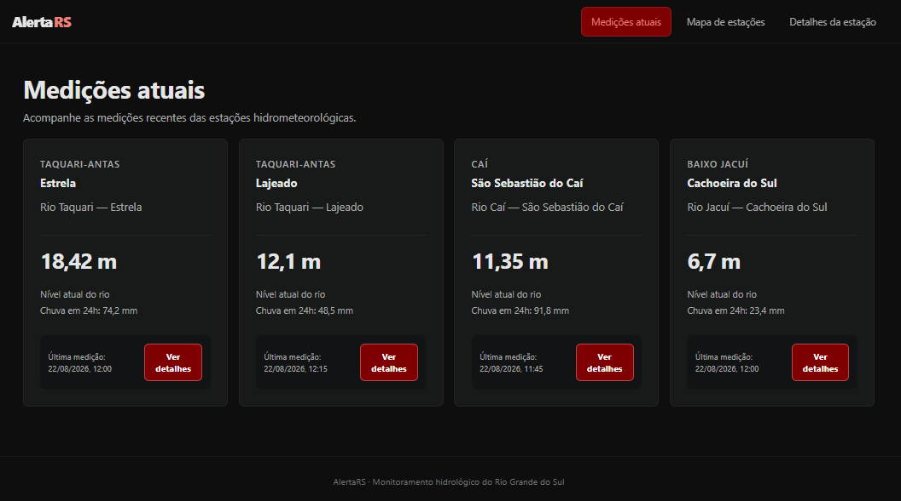
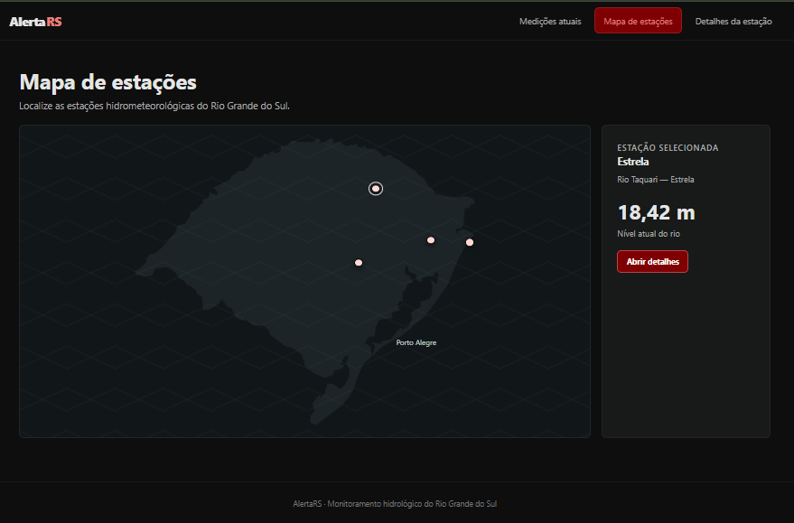
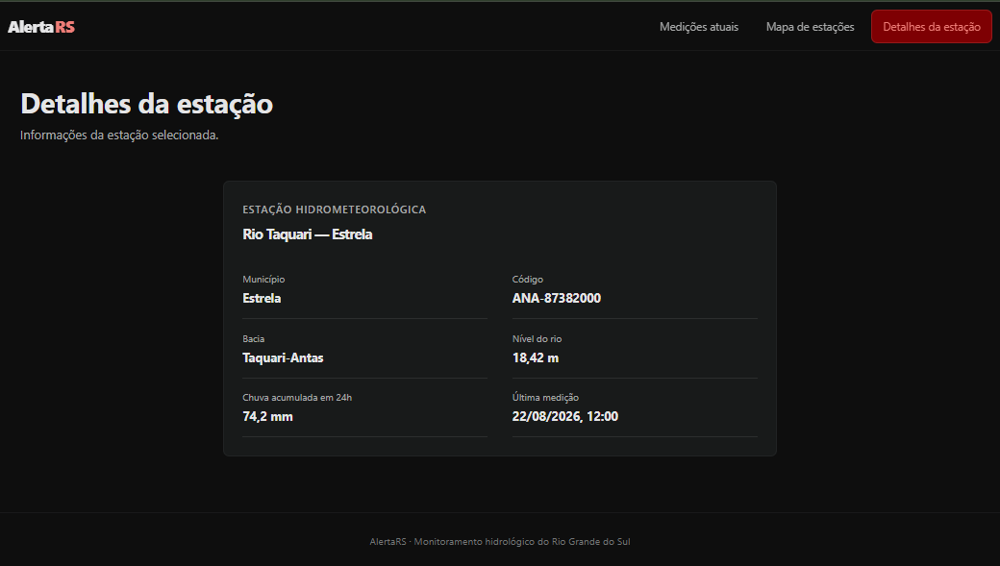

# UNIVERSIDADE DE CAXIAS DO SUL (UCS)
## Curso Superior de Tecnologia em Análise e Desenvolvimento de Sistemas
### Disciplina: Projeto Integrador IV-B (Interface Humano-Computador e Programação Front-End)

---

# Documento de Concepção e Prototipação — Etapa 1

**Título do Trabalho:** AlertaRS Web — Plataforma Cidadã de Monitoramento Hidrometeorológico e Alerta Precoce de Inundações  
**Integrantes do Grupo:**
- `[Nome do Integrante 1 - RA]`
- `[Nome do Integrante 2 - RA]`
- `[Nome do Integrante 3 - RA]`
- `[Nome do Integrante 4 - RA]`
- `[Nome do Integrante 5 - RA]`

---

## 1. Nome do Projeto
**AlertaRS Web** — *Plataforma Integrada de Monitoramento Hidrometeorológico em Tempo Real e Alerta Precoce*.

---

## 2. Objetivo do Sistema

### 2.1 Contexto e Justificativa Social
O Rio Grande do Sul enfrentou recentemente os episódios mais severos de inundações e desastres hidrometeorológicos da sua história. Em cenários de emergência climática e retomada socioeconômica, o acesso tempestivo, transparente e compreensível a informações hidrológicas confiáveis torna-se questão direta de segurança pública e preservação da vida.

Embora órgãos governamentais — como a Defesa Civil do Estado e agências de monitoramento — disponibilizem dados abertos telemétricos de réguas e pluviômetros, esses dados encontram-se frequentemente em formatos estritamente técnicos, dispersos em tabelas de difícil leitura ou em plataformas inacessíveis pelo celular para o cidadão sem treinamento específico.

### 2.2 Objetivo Geral
Desenvolver e prototipar a interface de uma aplicação Web responsiva, acessível e centrada no usuário, cujo propósito é consolidar e democratizar dados abertos de monitoramento hidrometeorológico em tempo real no Rio Grande do Sul, oferecendo uma experiência de uso intuitiva tanto para moradores de áreas vulneráveis quanto para voluntários e gestores públicos.

### 2.3 Objetivos Específicos
1. **Democratizar a Informação:** Traduzir medições complexas de cota de rios (centímetros/metros) e índices pluviométricos (mm em 24h) em status visuais claros e imediatos (*Normal*, *Atenção*, *Alerta*, *Inundação*).
2. **Promover Resiliência Comunitária:** Permitir que munícipes de cidades e bairros do interior e da região metropolitana do RS identifiquem com rapidez os riscos hidrológicos locais.
3. **Aplicar Princípios de IHC e Acessibilidade:** Assegurar que a interface atenda aos critérios WCAG 2.2 AA (alto contraste, navegação por teclado e compatibilidade com leitores de tela) e às 10 Heurísticas de Nielsen, garantindo legibilidade e rapidez de resposta mesmo sob estresse cognitivo.

---

## 3. Características e Funcionalidades do Sistema

As funcionalidades foram estruturadas a partir de um processo de descoberta empírica simulado com potenciais usuários e representantes comunitários (moradores ribeirinhos de bacias críticas como Taquari-Antas, Jacuí e Sinos, bem como voluntários de apoio civil).

### 3.1 Síntese do Levantamento com Usuários (Entrevista / Coleta de Dores)
* **Dor 1 (Sobrecarga de dados x Falta de clareza):** *"Não sei quantos centímetros faltam para o rio transbordar na minha rua; preciso saber se devo erguer os móveis agora ou se está sob controle."*
* **Dor 2 (Acesso móvel em conexão lenta):** *"Em dias de temporais fortes a internet oscila muito. Páginas pesadas e cheias de gráficos lentos travam o celular."*
* **Dor 3 (Localização geográfica):** *"Preciso ver no mapa se a água está subindo na cidade vizinha, rio acima, antes de chegar ao meu bairro."*

### 3.2 Matriz de Funcionalidades do Sistema Web

| ID | Funcionalidade | Descrição | Valor Social / Impacto |
| :--- | :--- | :--- | :--- |
| **F01** | **Painel Geral de Resumo e Indicadores (Home)** | Exibição consolidada dos principais cartões de monitoramento hidrológico: total de estações monitoradas, rios em cota de alerta/inundação e atualização temporal contínua. | Consciência situacional imediata em poucos segundos. |
| **F02** | **Filtros e Busca por Município / Bacia** | Campo de pesquisa instantânea para localização por município, nome do rio ou código da estação hidrológica. | Redução drástica do tempo de busca pelo dado local relevante. |
| **F03** | **Classificação Semântica por Nível de Risco** | Categorização visual padronizada por cores (*Normal*, *Atenção*, *Alerta*, *Inundação*) com suporte a ícones para daltônicos. | Redução da carga cognitiva e rápida interpretação da severidade. |
| **F04** | **Mapa Geográfico Interativo do RS** | Visualização espacial de todas as estações sobre o mapa do Rio Grande do Sul com marcadores interativos com código de cores e modal informativo. | Visão sistêmica da bacia hidrográfica e do deslocamento da cheia. |
| **F05** | **Ficha de Telemetria Detalhada da Estação** | Tela/painel específico exibindo cota do rio, limiares de transbordamento, acumulado de chuva (1h, 3h, 6h, 12h, 24h) e histórico recente. | Subsídio para tomada de decisão preventiva e logística comunitária. |
| **F06** | **Central Rápida de Segurança e Contatos de Emergência** | Acesso direto a números úteis (Defesa Civil 199, Bombeiros 193) e orientações de evacuação preventiva. | Apoio direto à vida e orientação para condutas seguras. |

---

## 4. Requisitos de Usuário e Critérios de IHC

### 4.1 Perfis de Usuários

#### Usuário Primário: Morador de Área Vulnerável (Cidadão Comum)
* **Perfil:** Maria Helena, 48 anos, moradora de bairro próximo ao leito do rio, usuária básica de smartphone (Android), costuma acompanhar notícias por WhatsApp.
* **Objetivos:** Saber rapidamente se o rio da sua cidade está subindo rápido; entender se há risco iminente de alagamento; encontrar canais oficiais de socorro sem complicação.
* **Restrições:** Estresse elevado durante chuvas fortes; possíveis falhas de conexão de rede móvel 4G; baixa familiaridade com termos hidrológicos técnicos.

#### Usuário Secundário: Voluntário Comunitário / Apoio à Defesa Civil
* **Perfil:** Carlos Eduardo, 29 anos, voluntário em centro de triagem de doações e monitoramento comunitário.
* **Objetivos:** Consultar dados detalhados de chuva acumulada nas últimas 24h em estações à montante (rio acima); acompanhar o mapa de estações para prever áreas que necessitarão de suporte logístico.
* **Restrições:** Utiliza tanto computador desktop quanto celular; necessita de visualização rápida em mapa e listagens filtráveis.

---

### 4.2 Requisitos Funcionais (RF)

* **RF01:** O sistema deve exibir na tela inicial os indicadores consolidados do estado e a lista das estações monitoradas.
* **RF02:** O sistema deve categorizar cada estação hidrológica em um dos quatro níveis de criticidade: *Normal*, *Atenção*, *Alerta* e *Inundação*.
* **RF03:** O sistema deve permitir que o usuário filtre as estações por nome da cidade, nome do rio e nível de risco.
* **RF04:** O sistema deve disponibilizar um mapa interativo do RS com a plotagem georreferenciada de todas as estações telemétricas.
* **RF05:** O sistema deve permitir a seleção de qualquer estação no mapa ou na lista para visualização da ficha completa com telemetria detalhada.
* **RF06:** O sistema deve indicar a data, horário e fonte oficial (Defesa Civil RS / ANA / CPTEC) de cada medição apresentada.
* **RF07:** O sistema deve disponibilizar atalhos de discagem e contato imediato para serviços de emergência (199 e 193).

---

### 4.3 Requisitos Não Funcionais e Critérios de IHC (Interface Humano-Computador)

#### A. Usabilidade e Heurísticas de Nielsen
1. **Visibilidade do Estado do Sistema (Heurística 1):** Indicador constante de "Última atualização em [Horário]" e sinalizador visual de status online/offline de dados.
2. **Correspondência entre o Sistema e o Mundo Real (Heurística 2):** Uso de vocabulário direto ("Nível do Rio", "Chuva nas últimas 24h", "Cota de Inundação") em substituição a códigos de engenharia hidrológica complexos.
3. **Consistência e Padrões (Heurística 4):** Cores padronizadas em todo o sistema (Verde = seguro; Vermelho = emergência); componentes de navegação familiares no topo da página.
4. **Reconhecimento em vez de Memorização (Heurística 6):** Cards autoexplicativos com legendas explícitas, sem exigir que o usuário decore limites de cotas.

#### B. Acessibilidade (Diretrizes WCAG 2.2 Nível AA)
* **Contraste de Cores (Critério 1.4.3):** Razão de contraste mínima de 4.5:1 para textos normais e 3:1 para componentes de interface em relação ao fundo.
* **Não dependência exclusiva de cores (Critério 1.4.1):** Todos os avisos e status críticos possuem rótulo textual e ícone representativo associado, permitindo plena compreensão por pessoas com daltonismo.
* **Navegação por Teclado e Foco Visível (Critério 2.4.7):** Todos os botões, campos de filtro e marcadores interativos são focáveis e operáveis via tecla `Tab` e `Enter`.
* **Semântica HTML5 e Leitores de Tela:** Uso de tags semânticas (`<header>`, `<nav>`, `<main>`, `<section>`, `<article>`, `<footer>`) e atributos ARIA (`aria-live="polite"`, `aria-label`) para alertas sonoros adequados.

#### C. Responsividade e Desempenho
* **Design Mobile-First:** Interface totalmente adaptável a telas a partir de 320px de largura, com botões e alvos de toque com dimensão mínima de 44x44px.
* **Carregamento Otimizado:** Minimização de dependências pesadas na carga inicial para garantir navegabilidade em conexões móveis degradadas.

---

## 5. Wireframes (Baixa Fidelidade)

Os protótipos de baixa fidelidade foram estruturados para mapear o fluxo de informação e a disposição ergonômica dos blocos de conteúdo antes do refinamento estético.

### 5.1 Wireframe 1 — Tela Inicial / Painel de Medições Atuais
O objetivo desta tela é apresentar um resumo situacional em nível macro com acesso imediato às estações de monitoramento.

* **Detalhamento dos Elementos de Interface:**
  * **Header Superior:** Logotipo do AlertaRS à esquerda; menu de navegação central ("Painel", "Mapa", "Sobre"); indicador temporal de atualização à direita.
  * **Banner de Status Geral:** Faixa destacada informando a condição meteorológica predominante no estado e contagem de municípios sob alerta.
  * **Barra de Busca e Filtros Rápidos:** Campo de texto para digitação livre (cidade/rio) e botões de filtro rápido (*Todos*, *Alerta*, *Inundação*).
  * **Grade de Cards de Estação:** Cartões modulares contendo:
    * Nome da estação e município;
    * Nível atual do rio acompanhado de badge de severidade;
    * Volume de chuva acumulada em 24h;
    * Botão de ação "Ver Detalhes Completos".
  * **Rodapé:** Links para órgãos oficiais, contatos de emergência e termos de uso de dados públicos.

---

### 5.2 Wireframe 2 — Mapa Georreferenciado de Estações
Esta tela atende à necessidade de visão geoespacial das estações hidrometeorológicas no território gaúcho.

* **Detalhamento dos Elementos de Interface:**
  * **Barra Lateral / Painel Flutuante:** Ferramenta de busca e listagem lateral compacta das estações ativas.
  * **Área Central do Mapa:** Visualização cartográfica com a malha dos rios e contorno dos municípios do RS.
  * **Marcadores Telemétricos:** Ícones circulares posicionados nas coordenadas exatas, com código de cor representativo do nível de criticidade.
  * **Controles de Mapa:** Botões de zoom in/out, redefinição de vista geral e botão de geolocalização do usuário ("Minha Localização").
  * **Tooltip / Card Flutuante de Seleção:** Ao clicar em um marcador, abre-se uma janela de prévia com nome do rio, nível atual e link para a ficha técnica.

---

### 5.3 Wireframe 3 — Ficha de Telemetria e Detalhes da Estação
Esta tela aprofunda os indicadores técnicos de uma estação específica selecionada.

* **Detalhamento dos Elementos de Interface:**
  * **Botão "Voltar ao Painel":** Navegação segura para retornar ao fluxo anterior.
  * **Cabeçalho da Estação:** Nome oficial, código da estação ANA/Defesa Civil, rio monitorado e município.
  * **Card de Cota e Nível:** Valor numérico em destaque com barra visual de progresso comparando o nível atual contra as cotas de atenção, alerta e transbordamento.
  * **Matriz de Precipitação:** Tabela ou cards segmentados exibindo chuva acumulada nos intervalos de 1 hora, 3 horas, 6 horas, 12 horas e 24 horas.
  * **Painel Meteorológico Complementar:** Informações sobre velocidade do vento, temperatura e pressão atmosférica.
  * **Botão de Compartilhamento Rápido:** Recurso para compartilhamento das informações em canais de comunicação com familiares ou equipes de apoio.

---

## 6. Mockup (Alta Fidelidade — Tela Inicial)

O protótipo de alta fidelidade foi desenvolvido com base no design system formulado para a aplicação, priorizando sobriedade visual, autoridade governamental/institucional e máxima legibilidade.

### 6.1 Detalhamento das Escolhas de Design da Interface

#### A. Identidade Visual e Tipografia
* **Fonte Primária:** `Inter` (Sans-Serif), com suporte a *tabular numbers* para que valores numéricos de medição permaneçam perfeitamente alinhados verticalmente.
* **Escala Tipográfica:**
  * Título da Aplicação / Destaque: `text-2xl` a `text-3xl` (24px a 30px, `font-bold`), com espaçamento equilibrado.
  * Indicadores Numéricos / Valores: `text-xl` a `text-2xl` (`font-extrabold`), garantindo leitura veloz.
  * Rótulos e Metadados: `text-xs` a `text-sm` (`font-medium`, `text-slate-400` a `text-slate-300`), facilitando distinção hierárquica.

#### B. Paleta de Cores e Semântica de Risco
O sistema adota um tema escuro (*Dark Mode* de alto contraste) com fundo em azul-marinho profundo (`#0B132B` / `#1C2541`), reduzindo o consumo de bateria em smartphones com telas OLED e diminuindo o cansaço visual.

| Nível de Severidade | Cor Hexadecimal | Aplicação no Mockup | Rótulo Acessível Associado |
| :--- | :--- | :--- | :--- |
| **Normal** | `#10B981` (Esmeralda) | Badge e borda de cartões com cota segura. | "Nível Normal / Estável" |
| **Atenção** | `#F59E0B` (Âmbar) | Marcadores e avisos de tendência de elevação. | "Estado de Atenção" |
| **Alerta** | `#F97316` (Laranja) | Estações próximas ao limite de segurança. | "Cota de Alerta" |
| **Inundação / Emergência**| `#EF4444` (Vermelho Vivo) | Estações em transbordamento ou iminência. | "Inundação Iminente" |
| **Fundo / Superfícies** | `#0F172A` / `#1E293B` | Base estrutural dos cards, barras e painéis. | - |
| **Texto Principal** | `#F8FAFC` (Slate 50) | Títulos e números com contraste > 10:1. | - |

#### C. Elementos Gráficos e Ícones
* **Ícones Vetoriais:** Utilização de ícones SVG padronizados (Lucide Icons) representando chuva (`CloudRain`), nível de rio (`Waves`), alerta (`AlertTriangle`), localização (`MapPin`) e informações (`Info`).
* **Microinterações:** Efeitos de elevação suave (*hover*) nos cartões de estação (`translate-y-[-2px]`), transições graduais de cor (200ms) e foco com anel visível de 2px em azul ciano (`#06B6D4`) para navegação assistiva.

---

## 7. Relação entre Etapa 1 e Etapa 2

A concepção realizada nesta primeira etapa estabelece as diretrizes estéticas, arquiteturais e de requisitos que serão concretizadas no desenvolvimento do código-fonte na **Etapa 2**. 

Na Etapa 2, os protótipos de baixa e alta fidelidade servirão como especificação para a codificação dos componentes em **Next.js (App Router), TypeScript e Tailwind CSS**, integrando a biblioteca de mapas **Leaflet** e implementando a camada responsiva e acessível do front-end.

---

## 8. Avaliação por Pares — 1ª Etapa
*Conforme orientações da UCS, cada membro da equipe preencherá individualmente o formulário acadêmico de autoavaliação e avaliação mútua no prazo estipulado.*
